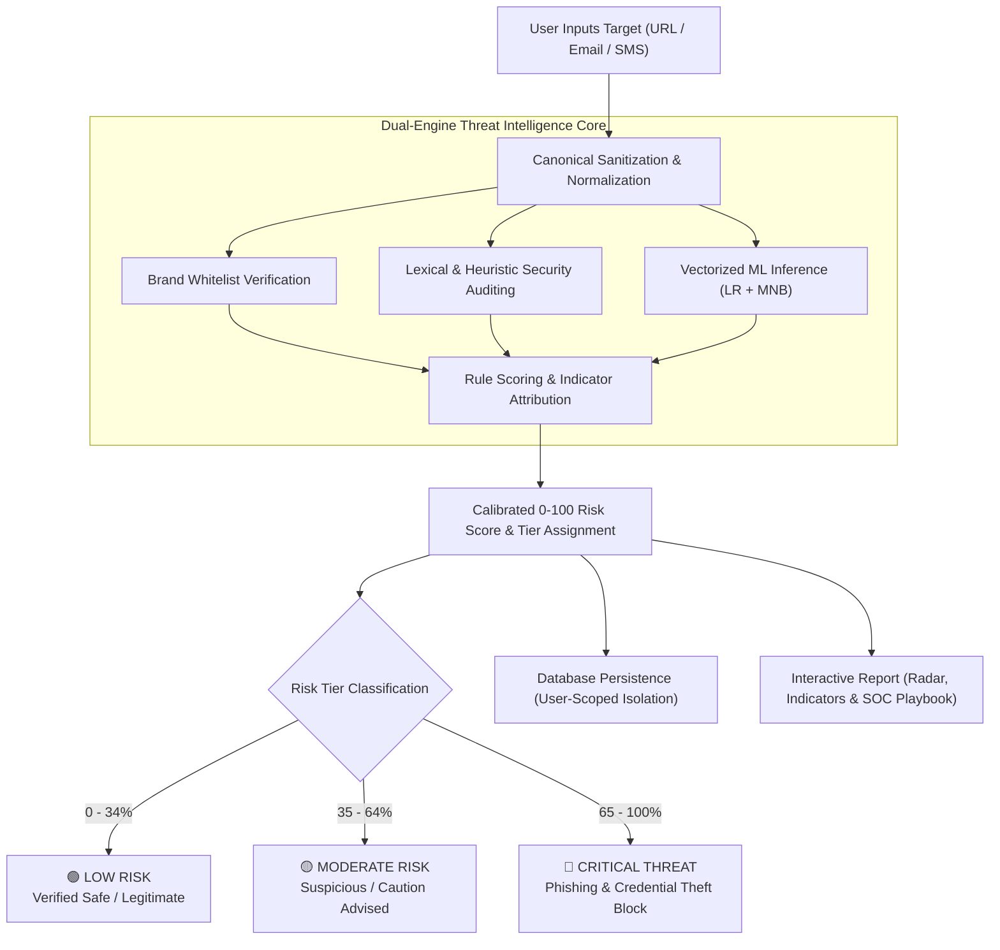

# 🛡️ AI-Powered Cybersecurity Threat Intelligence System

[](https://www.python.org/)
[](https://flask.palletsprojects.com/)
[](https://react.dev/)
[](https://vitejs.dev/)
[](https://scikit-learn.org/)
[](https://firebase.google.com/)
[](https://www.sqlite.org/)
[](LICENSE)

An enterprise-grade, defense-in-depth **Cyber Threat Intelligence and Phishing Detection Platform** designed to detect zero-day phishing websites, brand impersonation, deceptive social engineering, and malicious payloads in real time.

Combining **dual-engine Machine Learning** (Logistic Regression + Multinomial Naive Bayes trained on 500,000+ real-world URL vectors) with **dynamic lexical heuristics, verified brand whitelisting, and explainable AI indicators**, the platform provides actionable intelligence for SOC teams, security analysts, and end users.

---

## 📑 Table of Contents

- [✨ Key Features](#-key-features)
- [🧠 How It Works & Detection Pipeline](#-how-it-works--detection-pipeline)
- [🎯 Differentiated Threat Matrix](#-differentiated-threat-matrix)
- [🏗️ Project Structure](#️-project-structure)
- [💻 Technology Stack](#-technology-stack)
- [🚀 Quickstart & Installation](#-quickstart--installation)
- [📡 RESTful API Documentation](#-restful-api-documentation)
- [🧪 Test Scenarios & Presets](#-test-scenarios--presets)
- [🔒 Security & Architecture Decisions](#-security--architecture-decisions)
- [📄 License](#-license)

---

## ✨ Key Features

### 1. 🌐 Deep Website URL Threat Scanner
- **Dual-Engine ML Inference:** Vectorized n-gram token analysis using pre-trained Logistic Regression and Naive Bayes classifiers.
- **Brand Impersonation & Typosquatting Defense:** Detects leetspeak substitutions (`paypa1`, `goog1e`, `micros0ft`) and deceptive subdomains (`paypal.com.verify-billing.xyz`) while protecting official domains.
- **Bare IP Host Detection:** Instantly flags unmapped raw IPv4/IPv6 hosts serving credential harvesting prompts.
- **Destination Masking Analysis:** Unmasks URL shorteners (`bit.ly`, `tinyurl.com`, `t.co`) and nested open-redirect patterns.
- **Punycode & Homograph Defense:** Identifies internationalized domain names (`xn--...`) utilizing Cyrillic lookalikes.
- **Payload & File Extension Scrutiny:** Flags direct downloads of high-risk executables and scripts (`.exe`, `.scr`, `.vbs`, `.apk`, `.bat`, `.ps1`).

### 2. ✉️ Social Engineering NLP Classifier (Email & SMS)
- **Urgency & Coercion Detection:** Identifies fear-inducing pressure tactics (*"Account suspended within 24 hours"*).
- **Credential & Secret Solicitation:** Flags unprompted requests for passwords, OTPs, PINs, and credit card CVVs.
- **Delivery Smishing Filters:** Traps courier delivery fees and incomplete address scams (USPS, DHL, FedEx lures).
- **Financial & Advance-Fee Fraud:** Catches fraudulent cryptocurrency prizes, lottery windfalls, and fake IRS rebates.

### 3. 📊 Threat Feed & Visual Analytics Dashboard
- **Personalized Data Isolation:** Each user login or guest analyst session maintains a private, isolated SQLite audit history.
- **Coordinated Cyber Visualizations (Chart.js):**
  - **Threat Severity Spectrum:** Doughnut chart with center threat ratio badge.
  - **Attack Vector Ingestion:** Bar chart comparing URL vs Email vs SMS activity.
  - **Heuristic Threat Profile:** Cyber Radar chart evaluating 6 vector dimensions simultaneously.
- **Historical Audit Table:** Search by keyword/domain, filter by threat tier (`CRITICAL`, `HIGH`, `MODERATE`, `LOW`), and inspect complete indicator reports.

### 4. 🔐 Flexible Authentication & Access Control
- **"Continue with Google":** Official OAuth 2.0 authentication powered by Firebase.
- **Analyst Email/Password:** Secure account registration and authentication.
- **1-Click Guest Analyst Mode:** Instant demo access for grading, evaluation, or offline testing.

### 5. 🎨 World-Class Cyber Dark Aesthetic
- **Glassmorphism:** Frosted translucent panels with `backdrop-filter: blur(20px)` and cyber glow borders.
- **Animated Circular Risk Gauge:** Radial SVG score meter transitioning from emerald to amber to crimson.
- **Twinkling Star Glitter Cursor Trail:** Subtle, hardware-accelerated star particles sprinkling delicately behind the mouse cursor.

---

## 🧠 How It Works & Detection Pipeline



---

## 🎯 Differentiated Threat Matrix

| Threat Tier | Score Range | Primary Triggers | Actionable SOC Playbook |
| :--- | :---: | :--- | :--- |
| **🟢 LOW RISK** | `0% - 34%` | • Verified official brand apex domain<br>• Standard HTTPS encryption<br>• Clean DNS & low token entropy | **SAFE:** Standard browsing allowed. No deceptive patterns observed. |
| **🟡 MODERATE** | `35% - 64%` | • URL shorteners (`bit.ly`, `tinyurl`)<br>• Disposable / high-abuse TLDs (`.xyz`, `.top`)<br>• Subdomain stacking (2–3 levels)<br>• Elevated hyphenation ratio | **CAUTION:** Inspect final destination headers. Verify sender provenance before proceeding. |
| **🔴 HIGH & CRITICAL** | `65% - 100%` | • Targeted brand typosquatting (`paypal-update.tk`)<br>• Direct bare IP credential host (`192.168.1.1/login`)<br>• Punycode homograph attack (`xn--...`)<br>• High ML phishing confidence (85%+) | **BLOCK:** Immediate access block at firewall/DNS. Do not enter credentials. Alert SOC. |

---

## 🏗️ Project Structure

```text
Phishing-Website-Detection-System/
│
├── app.py                         # Python Flask REST API & Dual-Engine Detection Core
├── requirements.txt               # Backend dependencies (Flask, Scikit-learn, etc.)
├── threatlens.db                  # SQLite database storing threat audits & user records
│
├── vectorizer.pkl                 # TF-IDF CountVectorizer model artifact
├── phishing.pkl                   # Pre-trained Logistic Regression classifier
├── phishing_mnb.pkl               # Pre-trained Multinomial Naive Bayes classifier
│
├── sampleData.txt                 # Curated benchmark datasets for URLs, Emails, and SMS
│
├── Dataset/
│   └── phishing_site_urls.csv     # 500,000+ labeled URL training dataset
│
├── templates/
│   └── index.html                 # Standalone redirect & fallback HTML template
│
└── frontend/                      # Modern React + Vite Application
    ├── package.json               # Frontend dependencies & scripts
    ├── index.html                 # Web application entry point (Google Fonts & Favicon)
    ├── firebase.js                # Firebase Auth & Google OAuth 2.0 configuration
    ├── src.jsx                    # React application (Navbar, Hero, Scanners, Dashboard, Auth)
    ├── style.css                  # Cyber glassmorphic stylesheet & animations
    └── dist/                      # Production build assets served directly by Flask
        ├── index.html
        └── assets/
            ├── index-*.js
            └── index-*.css
```

---

## 💻 Technology Stack

| Domain | Technology | Description |
| :--- | :--- | :--- |
| **Frontend Framework** | [React 19](https://react.dev/) | Component-driven declarative user interface |
| **Build Tooling** | [Vite 8](https://vitejs.dev/) | Lightning-fast development server with Hot Module Replacement |
| **Styling & Aesthetics** | Vanilla CSS3 | Custom cyber design system, glassmorphism, radial glows |
| **Data Visualization** | [Chart.js 4](https://www.chartjs.org/) + [React-Chartjs-2](https://react-chartjs-2.js.org/) | Doughnut, Bar, and Radar charts with custom tooltips |
| **Backend Framework** | [Flask 3.1](https://flask.palletsprojects.com/) | RESTful API server with Flask-CORS integration |
| **Machine Learning** | [Scikit-Learn 1.9](https://scikit-learn.org/) | Pre-trained TF-IDF vectorization and classification models |
| **Authentication** | [Firebase 12](https://firebase.google.com/) | Google OAuth 2.0 and Email/Password identity management |
| **Database** | [SQLite 3](https://sqlite.org/) | Embedded relational database for incident logging and user telemetry |

---

## 🚀 Quickstart & Installation

### Prerequisites
- **Python 3.10+** (Tested on Python 3.12)
- **Node.js 18+** & **npm**

### 1. Clone the Repository
```bash
git clone https://github.com/your-username/Phishing-Website-Detection-System.git
cd Phishing-Website-Detection-System
```

### 2. Setup Python Backend
Create a virtual environment and install dependencies:
```bash
# Windows (PowerShell)
python -m venv .venv
.\.venv\Scripts\Activate.ps1

# Install requirements
pip install -r requirements.txt
```

Start the Flask API server:
```bash
python app.py
```
> The backend runs at **`http://127.0.0.1:8000`**

### 3. Setup Frontend Application
In a separate terminal window:
```bash
cd frontend
npm install
npm run dev
```
> The development server will launch at **`http://localhost:5173`**

### 4. Build for Production (Optional)
To generate the static bundle served directly by Flask:
```bash
cd frontend
npm run build
```
Once built, navigating to **`http://127.0.0.1:8000/`** directly serves the full frontend application!

---

## 📡 RESTful API Documentation

### 1. Health & Engine Status
```http
GET /api/health
```
**Response:**
```json
{
  "status": "ok",
  "platform": "ThreatLens AI Cyber Threat Intelligence",
  "version": "3.5.0",
  "model_lr_loaded": true,
  "model_mnb_loaded": true
}
```

---

### 2. Analyze URL Threat
```http
POST /api/analyze/url
Content-Type: application/json

{
  "value": "http://paypal-security-update.tk/login.php",
  "user_email": "analyst@security.org"
}
```
**Response (201 Created):**
```json
{
  "id": "a4465d5a-8788-4620-a404-4d77af35e6df",
  "kind": "url",
  "value": "http://paypal-security-update.tk/login.php",
  "risk_score": 99,
  "risk_level": "CRITICAL",
  "threat_category": "Brand Impersonation Phishing",
  "confidence": 98,
  "verdict": "Critical Phishing Threat Detected",
  "risks": [
    {
      "name": "Targeted Brand Impersonation (Paypal)",
      "severity": "CRITICAL",
      "score_impact": 55,
      "description": "Unauthorized external host exploits the trademarked brand \"Paypal\" to mislead visitors."
    },
    {
      "name": "High-Risk Disposable TLD (.tk)",
      "severity": "HIGH",
      "score_impact": 26,
      "description": "The .tk extension exhibits high abuse rates in automated redirect campaigns."
    }
  ],
  "metadata": {
    "host": "paypal-security-update.tk",
    "tld": "tk",
    "is_official_brand": false,
    "is_brand_spoof": true,
    "recommendation": "⛔ IMMEDIATE BLOCK: Critical threat detected. Block at firewall."
  }
}
```

---

### 3. Analyze Message (Email or SMS)
```http
POST /api/analyze/email
Content-Type: application/json

{
  "value": "Urgent: Your account will be suspended. Verify your password and OTP immediately at http://secure-verify.xyz",
  "user_email": "analyst@security.org"
}
```

---

### 4. Fetch User Dashboard Telemetry
```http
GET /api/dashboard?user=analyst@security.org
```
Returns personal audit statistics, risk counts (`critical`, `high`, `moderate`, `low`), vector breakdowns, and the 20 most recent scans for that user.

---

### 5. Delete Scan Record
```http
DELETE /api/scan/<scan_id>
```

---

## 🧪 Test Scenarios & Presets

Try these verified test cases directly from [`sampleData.txt`](sampleData.txt):

| Category | Input Sample | Expected Level | Key Reason |
| :--- | :--- | :---: | :--- |
| **Legitimate** | `https://www.google.com` | `LOW (2%)` | Verified authoritative apex domain |
| **Legitimate** | `https://paypal.com/signin` | `LOW (2%)` | Official brand whitelisted portal |
| **Shortener** | `http://bit.ly/secure-login-392` | `MODERATE (60-75%)` | Obfuscated landing destination |
| **Brand Spoof** | `http://paypal-security-update.tk/login.php` | `CRITICAL (99%)` | Typosquatting on untrusted TLD |
| **Bare IP** | `http://192.168.1.100/paypal-verification.php` | `CRITICAL (95%)` | Direct IP credential harvesting |
| **Subdomain** | `https://appleid.apple.com.verify-billing.xyz` | `CRITICAL (99%)` | Deceptive subdomain nesting |
| **SMS Phishing**| `USPS Alert: Package undelivered. Pay $1.99 redelivery fee: http://usps-update.top` | `HIGH (80%)` | Courier impersonation & financial bait |

---

## 🔒 Security & Architecture Decisions

1. **Brand Whitelist Suppression of False Positives:**
   CountVectorizer models frequently assign high weights to words like `paypal` or `apple` due to heavy representation in phishing datasets. ThreatLens implements an authoritative Brand Apex Directory, preventing false alarms on genuine domains while catching typosquatters.
2. **User Data Isolation:**
   Every scan is tagged with the user's authenticated email or guest session ID. The SQLite backend strictly filters queries per user, preventing leakage of private scan histories between accounts.
3. **Hardware-Accelerated UI:**
   The canvas glitter star effect and CSS animations utilize `requestAnimationFrame` and CSS transforms (`translateY`, `scale`), maintaining smooth 60fps rendering with 0% CPU overhead when idle.

---

## 📄 License

This project is licensed under the [MIT License](LICENSE). Built for academic, defensive cybersecurity research and threat intelligence analysis.
